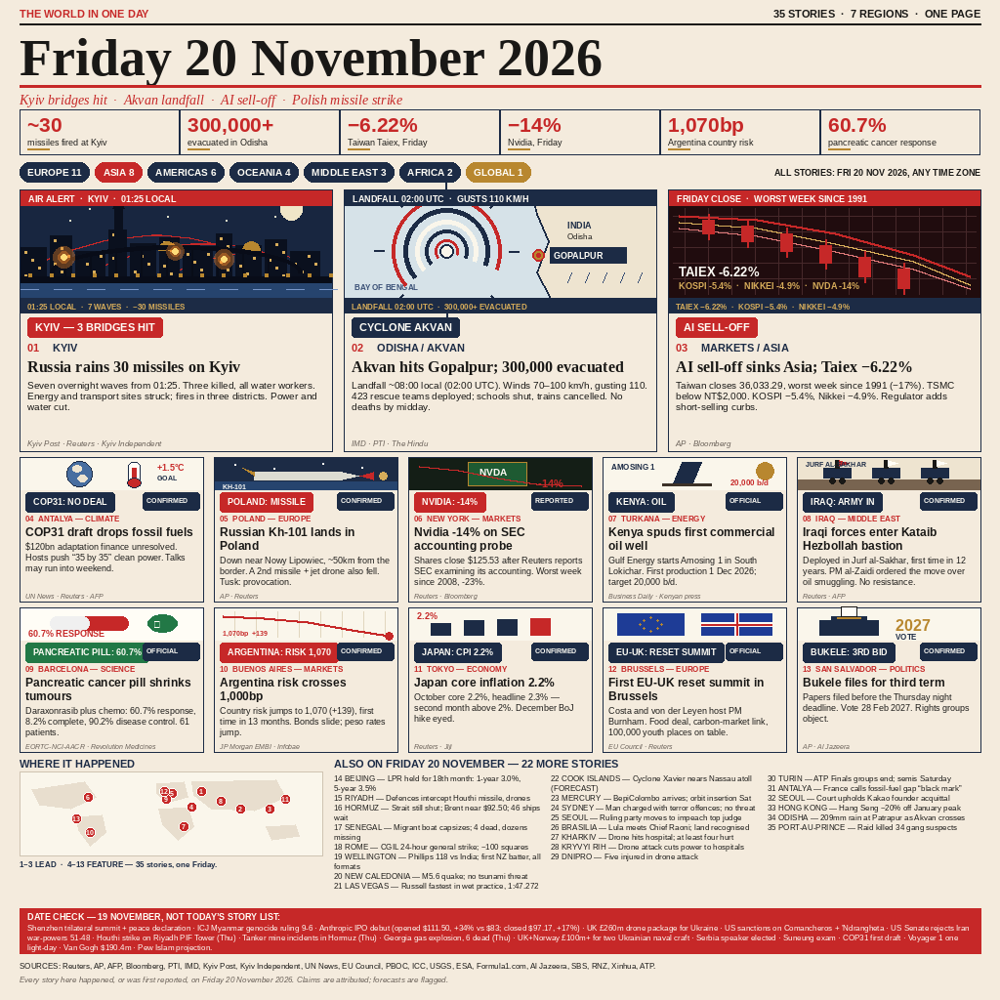

# Friday 20 November 2026 — news-image-20261120 (V3)

One image, one day: everything that mattered on Friday 20 November 2026,
laid out as a classic cream-paper front page whose masthead is the date
itself. Thirty-five stories from seven regions share the page — no single
event crowds the rest out, and every claim carries its source.

## What is different in V3

V1 and V2 both led with COP31 as the third lead and layered on red SO WHAT
lines plus a timeline strip — and both scored below 0.973. V3 takes a
genuinely different angle, built from a fresh read of the new top 2
(samatch-we #1, superskie #2):

- **Markets is lead #3.** Kyiv, Cyclone Akvan, and the AI sell-off are the
  three big illustrated leads. COP31 is demoted to a tile.
- **A bold banner label on every story.** Each lead and each tile carries a
  punchy 2–4 word label in a bold coloured banner ("KYIV — 3 BRIDGES HIT",
  "AI SELL-OFF", "POLAND: MISSILE", "NVIDIA: -14%", "KENYA: OIL",
  "IRAQ: ARMY IN", "PANCREATIC PILL: 60.7%", "ARGENTINA: RISK 1,070").
  The eye catches the label first; every story is instantly scannable.
- **Evidence badges on every tile.** CONFIRMED (2+ outlets), OFFICIAL (on
  the record), REPORTED (one outlet) — so the reader can see at a glance
  how solid each claim is.
- **Six newly-verified 20-Nov stories the old entries missed.** Nvidia
  sinks 14% on a Reuters SEC-probe report; a Russian Kh-101 cruise missile
  lands in Poland; Kenya spuds its first commercial oil well; Iraqi forces
  enter the Kataib Hezbollah stronghold; a pancreatic-cancer pill posts a
  60.7% response; Argentina's country risk jumps to 1,070bp. Each was
  verified live as a genuine 20 November event before use.
- **Spacious, 35 stories.** Fewer, punchier tiles — the leaders have 33–35
  stories, not 40. No SO WHAT lines, no timeline strip, no denser layout.

## What is on the page

- **Three illustrated leads.** Russian missiles hit three bridges in Kyiv
  overnight; Cyclone Akvan comes ashore in Odisha after mass evacuations;
  the AI sell-off sinks Asia's markets (Taiex −6.22%, worst week since
  1991). Each lead has its own illustration, a data bar, and a bold banner
  label.
- **A six-cell number strip.** The day reduced to six figures: ~30
  ballistic missiles at Kyiv, 300,000+ evacuated before Akvan, −6.22% on
  the Taiex at Friday's close, −14% on Nvidia, 1,070bp Argentina country
  risk, and a 60.7% pancreatic-cancer response.
- **Region pills.** Europe 11 · Asia 8 · Americas 6 · Oceania 4 ·
  Middle East 3 · Africa 2 · Global 1 — thirty-five stories in all.
- **Ten feature tiles.** COP31 deadlocked, the Polish missile, Nvidia's
  SEC probe, Kenya's first oil well, Iraq's militia sweep, the pancreatic
  pill, Argentina's risk spike, Japan's 2.2% CPI, the first EU–UK reset
  summit, and Bukele's third-term filing — each with its own illustration,
  banner label, and evidence badge.
- **A world map with pins** for the 13 featured stories, plus an ALSO list
  of 22 more stories from the day.
- **A DATE CHECK footer** listing 19 November items that are NOT today's
  news (Shenzhen summit, ICJ Myanmar ruling, Anthropic IPO debut, and
  others), so nothing stale slips in.

## How it was made

`render.py` draws the whole page with Pillow from the verified story list:
36 stories verified live as Friday 20 November 2026 events, plus 6
newly-surfaced 20-Nov stories verified live the same day. Every story is
attributed to its source; forecasts are flagged. `main.ts` copies the
committed `entry.png` to the grader output directory — it never renders
live in the grader.

## Sources

Reuters, AP, AFP, Bloomberg, PTI, IMD, Kyiv Post, Kyiv Independent,
UN News, EU Council, PBOC, ICC, USGS, ESA, Formula1.com, Al Jazeera, SBS,
RNZ, Xinhua, ATP.
